<picture>
  <source media="(prefers-color-scheme: dark)" srcset="https://raw.githubusercontent.com/sv3tli0/sv3tli0/output/hero-dark.svg">
  
</picture>

<div align="center">

[](https://sv3tli0.github.io/)
[](https://sv3tli0.github.io/#request)
[](https://www.linkedin.com/in/svetoslav-mutev/)
[](https://x.com/sv3tli0)
[](mailto:svetoslav.mutev@gmail.com)

</div>

I've been building for the web since 2012: PHP and Laravel on the back end, Vue on the front, Docker and CI/CD around it.
Since 2025 I run my own studio, **Frosko**, and build with a crew of AI agents. I design the system and make the calls,
the agents explore, plan, build and review in parallel, and nothing ships until I've signed it off.

<picture>
  <source media="(prefers-color-scheme: dark)" srcset="https://raw.githubusercontent.com/sv3tli0/sv3tli0/output/crew-dark.svg">
  
</picture>

<details>
<summary><b>How I run the crew</b></summary>

- **Scout first, fan out second.** Explore maps the codebase before anything gets planned.
- **Match the agent to the task.** Small models for lookups, the strong one for judgment and review.
- **Depth beats breadth.** A few specialists who know the stack beat a swarm of generalists.
- **Every change gets reviewed twice.** First by `code-reviewer`, then by me.
- **Refactors and features never share a commit.** Atomic, conventional commits, always on a branch.

</details>

<picture>
  <source media="(prefers-color-scheme: dark)" srcset="https://raw.githubusercontent.com/sv3tli0/sv3tli0/output/stack-dark.svg">
  
</picture>

<details>
<summary><b>The stack as plain text</b></summary>

| Back end | Front end & apps | Delivery & quality | AI & agents |
|:---|:---|:---|:---|
| PHP 5.2 → 8.5 | Vue 3.5, Nuxt 4, Inertia | Docker, Kubernetes | Claude Code + subagents |
| Laravel 5 → 13 | Quasar, Tauri 2 | Octane + FrankenPHP | Codex, Cursor |
| Symfony 2 → 8 | React 19, Alpine.js | GitHub Actions, GitLab CI | Laravel Boost, MCP servers |
| Filament 5, Cashier + Stripe | Tailwind v4, Vite 8 | AWS, GCP, Linux servers | Skills, hooks, workflows |
| Horizon, Reverb, Scout | TypeScript, Pinia | Pest, Larastan, Vitest | Anthropic & OpenAI APIs |
| MySQL, PostgreSQL, Redis | Directus (headless CMS) | Rust (Actix) services | n8n custom nodes |

</details>

<picture>
  <source media="(prefers-color-scheme: dark)" srcset="https://raw.githubusercontent.com/sv3tli0/sv3tli0/output/skyline-dark.svg">
  
</picture>

<sub>Almost all of my work lives in private repos, so the contribution calendar is its only public trace. This sheet is redrawn from it four times a day by <a href="profile-generator.php">a PHP script</a>.</sub>

## Quest log

### 🏆 Current quest: Frosko Ltd `[2025-present]`
> **Founder & full-stack developer.** Products and contract work, built with a crew of AI agents.
- Built in 2026: a creative writing studio (Tauri 2 + Vue 3 + Laravel 13), a cross-platform focus and routine app (Quasar, iOS, Android, web), a social publishing platform with its own n8n nodes, a Rust image pipeline and Laravel deploy tooling (Octane + FrankenPHP)
- My own agent crew (`lara`, `fronty`, `designer`, `code-reviewer`) and 22 skills that take a feature from kickoff to deploy
- Claude Code, Codex and Cursor, with MCP servers and hooks wired into the workflow

<details>
<summary><b>⚔️ Previous quests</b> (click to expand)</summary>

**Peoplefone AG** `[2023-2024]` — Senior Full-Stack Developer (Remote 🥷)
> Monolith maintenance & microservices migration · Laravel + Vue.js + Node.js · Solo remote in hybrid EU team

**Parkos BV** `[2021-2022]` — Senior Full-Stack Developer
> Parking rental platform · Laravel → JS microservices migration · Remote EU collaboration

**vConnect Ltd** `[2019-2020]` — Senior PHP Developer
> E-commerce architecture · Vue.js monitoring dashboard · Multi-language & multi-market

**Droxic Ltd** `[2017-2018]` — Mid/Senior PHP Developer
> Symfony, WordPress, Drupal, Magento · Clients: BMW, Doctors Without Borders · Rapid stack adaptation

**Training Arc** `[2012-2016]` — Junior → PHP Developer
> Circles Bulgaria · Comstream (Swedish hosting, still running! 🎉) · Rezon Media (Bulgaria's largest websites)

</details>

<details>
<summary><b>🧙‍♂️ Developer toolkit</b>: the PHP 8.4 profile that draws these sheets (click to expand)</summary>

```php
<?php declare(strict_types=1);

readonly class AIIntegrator
{
    public function __construct(
        private(set) array $codingTools = ['Claude Code', 'Codex', 'Cursor'],
        private(set) array $crew = ['Explore', 'Plan', 'lara', 'fronty', 'designer', 'code-reviewer'],
        private(set) array $infrastructure = ['Subagents', 'Skills & hooks', 'MCP Servers'],
    ) {}

    public function augmentWorkflow(string $task): string
    {
        return match($task) {
            'planning' => 'Explore scouts, Plan splits the work into parallel tracks',
            'coding' => 'lara, fronty and designer build in parallel',
            'review' => 'code-reviewer first, then a human final call',
            'shipping' => 'Nothing ships without review',
            default => 'Human decisions, agent throughput'
        };
    }
}

$svetoslav = new readonly class (
    backend: new BackendArchitect,
    frontend: new FrontendCraftsman,
    devOp: new DevOpsEngineer,
    ai: new AIIntegrator,
    location: 'Plovdiv, Bulgaria (REMOTE)',
    yearsOfExperience: (int) date('Y') - 2012,
    availability: new DateTimeImmutable()->add(new DateInterval('P1W')),
){
    public function __construct (
        private(set) BackendArchitect $backend,
        private(set) FrontendCraftsman $frontend,
        private(set) DevOpsEngineer $devOp,
        private(set) AIIntegrator $ai,
        private(set) string $location,
        private(set) int $yearsOfExperience,
        private(set) DateTimeImmutable $availability,
    ) {}
};
// Full source: profile-generator.php, drawing code in src/
```

</details>

---

<div align="center">

*"The best code is written by humans who know when to let AI handle the rest"* ✨


[](https://github.com/sv3tli0/sv3tli0/actions/workflows/update-profile.yml)

</div>
